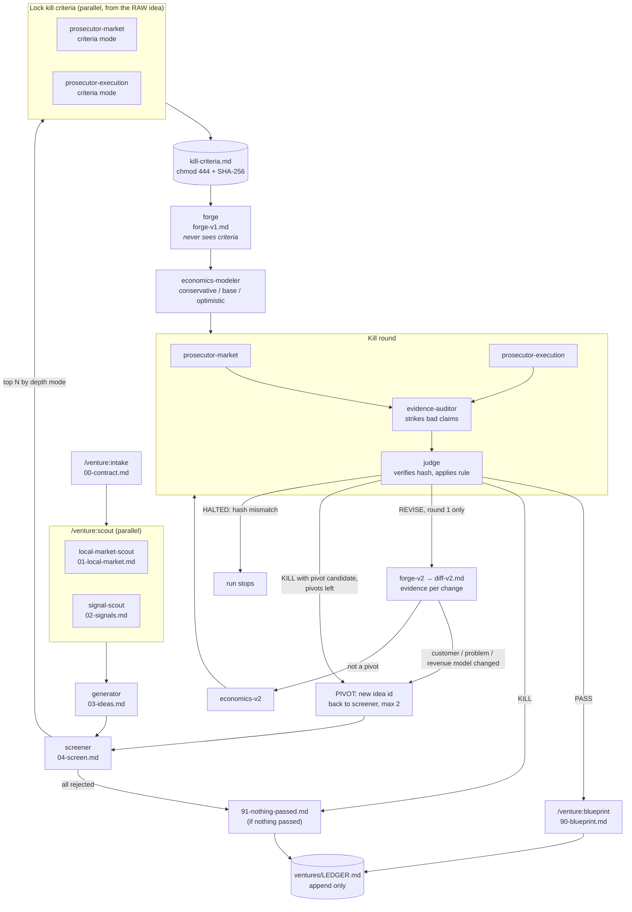

# venture

**A multi-agent Claude Code plugin that takes you from "I have an idea" — or "I have no idea" — to an honest verdict.**

`venture` scouts your market, generates ideas, and then tries hard to kill them. Ideas must survive blind prosecution against kill criteria locked *before* anyone polishes them, an evidence audit that strikes every unsourced or misquoted claim, and a judge who follows a fixed rule. It's modeled on Every's Compound Engineering plugin: specialist agents, files as the interface, and a ledger that makes every run smarter than the last.

A run ends one of two ways, and both are wins:

1. **PASS** — an idea with evidence that it can make money *for you*, under *your* constraints, in *your* market, plus a blueprint for testing it cheaply this week.
2. **NOTHING PASSED** — every idea that died, the evidence that killed it, and an estimate of the money and months you saved by not building it.

> This is research assistance, not financial advice.

## Philosophy: Kill can win

Most idea tools are built to say yes. This one isn't.

- **Kill can win.** A run where everything dies is a successful run. No agent is rewarded for a pass.
- **Criteria are locked before polishing.** Prosecutors write each idea's kill criteria from the raw one-liner. The file is made read-only and hashed. Forge (the agent that sharpens ideas) never sees it, and the judge refuses to rule if it changed.
- **A pass needs positive evidence.** Running out of objections is not a pass. You need verified demand (competitors with revenue, measurable search demand, or people already paying for something worse) *and* unit economics that work in the *conservative* case.
- **Fixes need evidence, not rhetoric.** In the single revision round, prosecutors see a structured diff with an evidence URL per change — never Forge's prose.
- **A pivot is a new idea.** Change the customer, the problem or the revenue model, and the idea goes back to screening from zero. Two pivots per run, max.
- **Locks are enforced, not just requested.** A plugin hook limits the judge's shell to hashing the locked criteria file. Nothing else runs.
- **Your constraint contract is law.** Capital, hours, skills, risk, time to revenue: HARD or FLEXIBLE with an explicit stretch condition. Only you can change it.
- **No invented facts.** Every claim has a URL or is labeled `ASSUMPTION`. Thin local data is admitted, not papered over with national numbers.

## Install

In Claude Code:

```
/plugin marketplace add ansharora2028-spec/founders-lab
/plugin install venture@venture
```

Or from your shell:

```bash
claude plugin marketplace add ansharora2028-spec/founders-lab
claude plugin install venture@venture
```

On Claude Code 2.1.275 or later, one line also works: `/plugin install venture --marketplace ansharora2028-spec/founders-lab`.

To try it from a local clone without installing: `claude --plugin-dir /path/to/founders-lab`.

Run it from the project folder where you want the `ventures/` workspace to live.

## Commands

| Command | What it does |
|---|---|
| `/venture:run` | The full pipeline, start to verdict. Start here. |
| `/venture:intake` | Builds your constraint contract (`00-contract.md`). |
| `/venture:scout` | Local-market and signal research, in parallel. |
| `/venture:generate` | Generates ideas, screens them, locks kill criteria for the top N. |
| `/venture:forge` | Sharpens each carried idea and models its unit economics. |
| `/venture:kill` | Prosecution, audit and verdict. Also works directly on any idea. |
| `/venture:blueprint` | Writes the blueprint (pass) or nothing-passed report, and updates the ledger. |
| `/venture:ledger` | Summarizes or searches past runs. |

### Examples

```text
/venture:run
```
Starts intake and asks you one topic at a time: starting point, location, target market, constraints, unfair advantages, depth.

```text
/venture:run Pune, India; target Pune; ₹1L capital HARD; 10 hrs/week HARD; B2C only; no idea yet; quick
```
Pre-fills intake answers. You'll only be asked for what's missing, then asked to confirm the contract.

```text
/venture:intake
/venture:scout
/venture:generate
/venture:forge
/venture:kill
/venture:blueprint
```
The same pipeline one stage at a time (each takes an optional run id; the default is the latest run).

```text
/venture:kill "a subscription laundry pickup service for students in Indore, ₹3L budget"
```
Direct verdict on an existing idea: a minimal intake (location and constraints only), locked criteria, economics, prosecution, audit, judgement. No forge, no revision.

```text
/venture:ledger
/venture:ledger Pune
/venture:ledger licensing
```
Summary of all past runs, or a search by location, idea, or cause of death.

## Depth modes

| Mode | Ideas generated | Carried to forge & kill | Agent calls (no revisions) |
|---|---|---|---|
| `quick` | 3 | 2 | ~20 |
| `standard` (default) | 8 | 3 | ~28 |
| `deep` | 12 | 5 | ~44 |

Cost scales mostly with the number of carried ideas: each one gets 2 criteria writers, forge, economics, 2 prosecutors, an auditor and a judge (8 calls), plus about 6 more if it earns a revision round, and a pivot starts a new idea from zero. In testing, a single carried idea cost roughly $3–4 end to end on the default models. Prosecutors, auditor and judge inherit your session model; the screener runs on Haiku; everything else runs on Sonnet. Each choice is one `model:` line in `agents/*.md` if you want to change it.

## The pipeline



In round 2, prosecutors receive `diff-v2.md` and `economics-v2.md` — never `forge-v2.md`. A REVISE in round 2 is a KILL.

## The run folder

Every run writes to your current project directory:

```
ventures/
├── LEDGER.md                       # persistent across runs
└── runs/<YYYY-MM-DD>-<slug>/
    ├── 00-contract.md              # constraint contract + location profile
    ├── 01-local-market.md          # local scout, with a 0–10 coverage score
    ├── 02-signals.md               # dated, sourced signals
    ├── 03-ideas.md                 # ideas, each citing signal ids
    ├── 04-screen.md                # hard-constraint check, competitors, ranking
    ├── ideas/<idea-id>/
    │   ├── criteria-market.md      # prosecutor drafts (pre-forge)
    │   ├── criteria-execution.md
    │   ├── kill-criteria.md        # LOCKED (read-only, hashed in run-log)
    │   ├── forge-v1.md
    │   ├── economics-v1.md
    │   ├── prosecution-market-v1.md
    │   ├── prosecution-execution-v1.md
    │   ├── audit-v1.md
    │   ├── verdict-v1.md
    │   ├── fixable-flaws-v1.md     # revision round only
    │   ├── forge-v2.md
    │   ├── diff-v2.md              # what prosecutors see instead of forge-v2
    │   ├── economics-v2.md
    │   └── …-v2.md
    ├── 90-blueprint.md             # only if something passed
    ├── 91-nothing-passed.md        # only if nothing passed
    └── run-log.md                  # stages, every agent call with exact paths, locks, pivots
```

Every file follows a fixed schema (`skills/file-schemas/SKILL.md`; empty copies in `templates/`). Claims look like `- [C07] <claim> [source: <url>]` or `[ASSUMPTION: <why>]`, so the auditor can check them and the judge can cite them. A complete fictional run is in [`examples/sample-run/`](examples/sample-run/).

## The ledger, and why it compounds

`ventures/LEDGER.md` gets one append-only entry per run: location, contract summary, outcome, every idea with its verdict, decisive reason and lens, which sources produced real signals and which were useless, local data coverage, and pivots used.

The next run reads it before doing anything:

- **Scouts** skip sources that proved useless for your location and favor the ones that worked.
- **The generator** won't regenerate an idea that already died under a similar contract and location unless it can name the material change (a new signal, a cost drop, a regulation) that justifies another look.
- **You** can search it (`/venture:ledger licensing`) to see what keeps killing your ideas.

Each run makes the next one cheaper and sharper. That's the compounding.

## Known limits

- **Thin local data.** For smaller cities, there's often little online evidence. The local scout says so, gives a low coverage score, and labels any national or global data. Verdicts get lower confidence. Expect more INSUFFICIENT EVIDENCE and more kills. That's the honest outcome, not a bug.
- **Cost.** Every stage that searches the web costs tokens. Each carried idea is about 8 agent calls, so `deep` costs roughly 2–2.5× `quick`. Start with `quick`.
- **Web evidence isn't ground truth.** The auditor checks that sources say what the claims say, not that the sources are right. A PASS means "the desk research holds up", not "this will work". The blueprint's experiments exist to test that in the real world.
- **Research assistance, not financial advice.** Nothing here is a recommendation to invest money. Talk to people who know your market before you spend real money.
- **Interactive intake works best.** In non-interactive sessions (`claude -p`), give every intake answer in the arguments; the plugin won't invent a constraint.

## Checking blindness yourself

Every agent call is logged with its exact input paths in `run-log.md`. To check against the real transcript instead of the log:

```bash
claude -p '/venture:run <your intake answers>' --output-format stream-json --verbose > run.log
python3 tests/check_blindness.py run.log
```

It fails if a prosecutor was passed or opened `forge-v2.md` or the other prosecutor's file, if forge or the economics modeler touched the kill criteria, or if any other agent broke the visibility matrix.

For a full end-to-end check (real web research, about $3–4 per carried idea): `sh tests/e2e.sh quick`. It runs the fictional Pune user through `/venture:run` headless and then runs the blindness checker on the transcript.

CI (`.github/workflows/ci.yml`) runs on every push: strict manifest validation, the schema and reference checks (`tests/check_schemas.py`), the judge-hook unit tests (`tests/test_judge_guard.sh`), and the blindness checker over recorded test transcripts (`tests/fixtures/`), including a planted leak it must catch.

## Roadmap (out of scope for v0.1)

- A Claude.ai app version
- Integrations (Airtable, Notion)
- Scheduled or recurring scouting
- More than 10 subagents

## Repository layout

```
.claude-plugin/plugin.json, marketplace.json   # name "venture" lives only here
agents/        10 specialist subagents
commands/      8 /venture:* commands (the orchestrator)
hooks/         judge-bash-guard: the judge's shell can only hash kill-criteria.md
skills/        venture-rules, scoring-rubric, idea-lenses, file-schemas
templates/     empty copies of every run file
examples/      a complete fictional run, plus revision-round and pivot examples
tests/         blindness, schema and hook checks, plus recorded transcript fixtures
.github/       CI workflow
DECISIONS.md   design choices where the spec was silent, and test results
```

## License

MIT. See [LICENSE](LICENSE).
