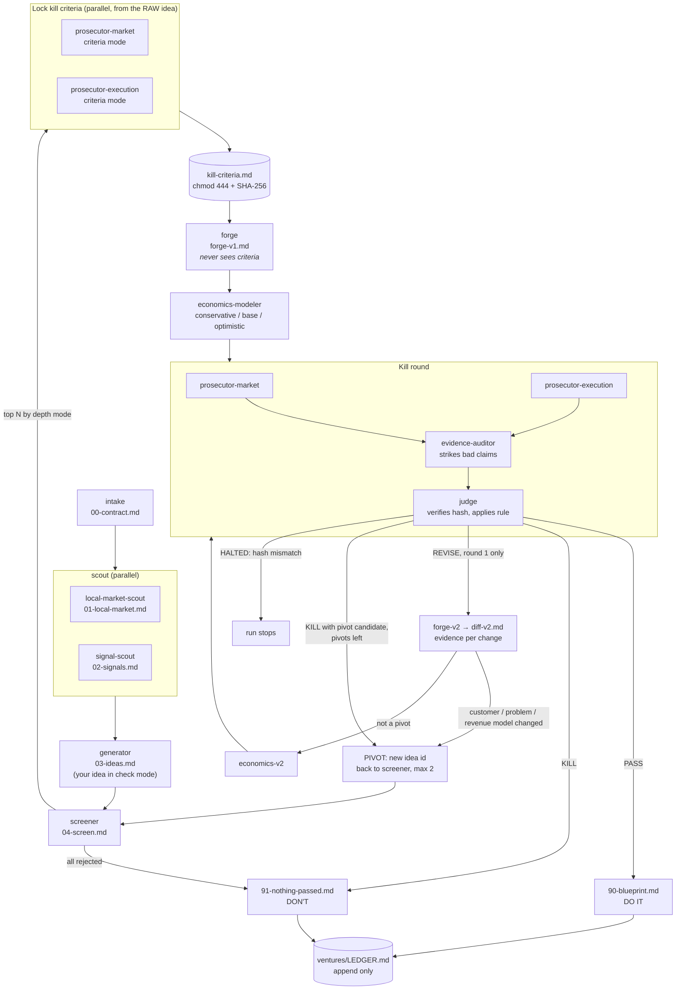

# venture

**Test a business idea on paper before you spend your savings finding out the hard way.**

Most new businesses don't fail because the founder wasn't hard-working. They fail because nobody wanted to pay, or because the numbers never added up, and the founder only found out after putting in months of time and money.

`venture` helps aspiring founders find that out *first*, for the cost of a few dollars of AI usage. It researches your market, comes up with ideas that fit your budget, time and skills (or takes the idea you already have), and then tries hard to kill each one. Each idea must pass a fixed checklist, written before anyone polishes the idea, and survive a fact-check of every claim. Only ideas that hold up get a green light.

You end up with one of two answers, and both are good news:

- ✅ **Do it.** You get an idea with real evidence that people pay for this and that the numbers work even in a cautious scenario, plus three cheap experiments to run this week.
- ❌ **Don't do it.** You get the reasons, the evidence, and an estimate of the money and months you just saved.

> `venture` is research help, not financial advice. A "do it" means the desk research holds up. You still test it in the real world, cheaply, before you spend real money.

---

## Who it's for

- You want to start something but don't know what.
- You have an idea and want an honest answer on whether it's worth doing.
- You have limited money and time, and can't afford to learn by failing.

You don't need a business background. Every idea is explained in plain language.

## What you'll see for every idea

```
I01 — WhatsApp voice-note spoken-English practice for Pune working adults, ₹299 for 30 days

  How it works:       You pay ₹299 by UPI and get a daily speaking prompt on WhatsApp. You send
                      back a one-minute voice note and get corrections and a model sentence,
                      explained in Hindi or Marathi if you want.
  The need gap:       Today these learners use free YouTube lessons or pay for fixed-time classes.
                      Neither gives feedback on their own speech at a time that suits them.
                      (The scouts found no Pune demand data, so this gap is marked as a guess.)
  How it makes money: ₹299 per 30-day pack. Delivery costs roughly ₹20–40 per customer per month,
                      so about 15 paying customers a month cover the running costs (an estimate).

  Verdict:            <PASS or KILL, with the judge's top reason and the files behind it>
```

That's a real idea card from a test run, lightly trimmed. The verdict line shows where the judge's ruling appears. Every number is either linked to a source or marked as an estimate.

---

## Get started in 3 steps

**1. Get Claude Code.** venture is a plugin for [Claude Code](https://claude.com/claude-code), Anthropic's AI assistant. It runs in your terminal, in the desktop app, or at claude.ai/code.

**2. Install venture.** Paste these two lines into Claude Code:

```
/plugin marketplace add ansharora2028-spec/founders-lab
/plugin install venture@venture
```

**3. Pick the command that matches where you are:**

| Where you are | Type this | What happens |
|---|---|---|
| **I have no idea yet** | `/venture:run` | It asks about you, researches your market, suggests ideas that fit you, and tests the best ones. |
| **I have an idea and want the full check** | `/venture:check "your idea"` | Your idea goes through the full process: market research, sharpening, money math in a cautious, a realistic and an optimistic case, a fact-checked prosecution, and one chance to fix weak spots. Then a clear **do it / don't do it**. |
| **I have an idea and want a quick verdict** | `/venture:kill "your idea"` | A faster, cheaper verdict on the idea exactly as you wrote it, with no research or improvement step. |

Examples:

```
/venture:check "home-cooked tiffin subscription for students near Pune University, ₹2,500/month"
/venture:check "online Excel classes for small shop owners in Hindi" --variants
/venture:kill "a new social network for everyone, ₹50k budget"
```

`--variants` also tests up to 3 versions of your idea, each changing one thing (a different customer, channel, price model or city). It carries the best variant alongside your original.

## What it will ask you

Before anything runs, venture asks a few questions, one at a time. Your answers become your **contract**, and every idea has to respect it:

1. **Your idea** (or that you don't have one yet), in your own words, and how you'd charge for it, if you know.
2. **Where you live**, and **who you want to sell to** (your city, your country, abroad, or online).
3. **Your limits:** money you can put in, hours per week, your skills, how much risk you can take, how soon you need income, B2B or B2C, and anything that's off-limits for you.
   For each limit you say whether it's **hard** ("never more than ₹1 lakh") or **flexible** ("₹1 lakh, up to ₹2 lakh if it pays back within 6 months").
4. **Any unfair advantage**, like a family business, a community you're part of, or industry contacts. This is optional.

It reads your answers back to you, and nothing starts until you confirm. Only you can change the contract.

## What happens next (plain version)

1. **Research.** Two researchers look at your city and target market (what sells, what failed, prices, competitors, rules and licences) and at recent trends.
2. **Ideas.** It writes up your idea, or suggests new ones from the research. Each comes with the three explanations above.
3. **Quick screen.** It drops anything that breaks your hard limits, checks for competitors, and ranks the rest.
4. **Lock the test.** Before anyone improves the idea, two critics write the exact conditions under which it should die. That checklist is then locked, so it can't be quietly softened later.
5. **Sharpen.** The idea is made specific: the exact customer, the smallest first version, how you'd find your first 100 customers, and the money math in three scenarios.
6. **Try to kill it.** The two critics test the idea against the locked checklist, and a fact-checker opens every cited source and throws out claims that don't hold. A judge then applies a fixed rule. It can only pass an idea with real evidence that people pay and money math that works in the cautious case.
7. **One second chance.** If the problems are fixable, the idea gets one revision, backed by evidence. If it fails again, it's done.
8. **Your answer.** You get either a **do-it plan** (the 3 cheapest experiments to run this week, what to build first and what to skip, pricing, a 30-day plan, and the warning signs that should make you stop) or a **don't-do-it report** (what killed each idea, the money and months saved, and what to try next).

Everything is saved in a `ventures/` folder in your project. A running log of every past check means future runs don't repeat ideas that already died for someone in your situation.

## Time and cost

| What you run | Typical time | Typical AI usage cost* |
|---|---|---|
| `/venture:kill "idea"` | a few minutes | about $2–3 |
| `/venture:check "idea"` | 10–20 minutes | about $3–5 |
| `/venture:check "idea" --variants` | 15–30 minutes | about $7–10 |
| `/venture:run` in `quick` mode (2 ideas tested) | about 15 minutes | about $7 |
| `/venture:run` in `standard` mode (3 ideas tested) | 20–40 minutes | about $10–12 |

\*On the default models. The `/venture:kill` and `quick` figures were measured in testing. The others are estimates, based on each fully tested idea costing roughly $3–4. A revision round or a pivot adds more.

## Good to know

- **Small cities have less data online.** venture says so plainly, never passes national numbers off as local, and lowers its confidence. Expect more "don't do it" answers there.
- **It's built to say no.** Most ideas die, and that's the point. One honest "no" now is cheaper than a year of trying.
- **It doesn't make things up.** Every fact has a link or is labeled as an estimate, and a fact-checker removes anything that doesn't hold up.
- **It needs web access.** The fact-checker has to open sources. If your network blocks sites, claims get struck and every idea dies, and venture warns you when that happens.

---

## Under the hood

The rest is for the curious and for contributors.

### The rules every agent follows

- **Kill can win.** A run where everything dies is a successful run. No agent is rewarded for a pass.
- **Criteria are locked before polishing.** Prosecutors write each idea's kill criteria from the raw idea. The file is made read-only and hashed. Forge (the agent that sharpens ideas) never sees it, and the judge refuses to rule if it changed.
- **A pass needs positive evidence.** Running out of objections is not a pass. A pass needs verified demand (competitors with revenue, measurable search demand, or people already paying for something worse) *and* unit economics that work in the *conservative* case.
- **Fixes need evidence, not rhetoric.** In the single revision round, prosecutors see a structured diff with an evidence URL per change, never Forge's prose.
- **A pivot is a new idea.** Change the customer, the problem or the revenue model, and the idea goes back to screening from zero. Two pivots per run, max. The judge may propose a pivot candidate on a KILL only when it rests on surviving evidence.
- **Locks are enforced, not just requested.** A plugin hook limits the judge's shell to hashing the locked criteria file.
- **The contract is law.** HARD limits are never crossed. A FLEXIBLE limit stretches only when its stated condition is met, and the stretch is flagged.
- **No invented facts.** Every claim has a URL or is labeled `ASSUMPTION`. Thin local data is admitted, not papered over with national numbers.

### All commands

| Command | What it does |
|---|---|
| `/venture:run` | The full pipeline, from no idea (or a space) to a verdict. |
| `/venture:check "<idea>" [--variants]` | The full pipeline on your own idea: scout, explain, screen, lock criteria, forge, economics, kill, one revision, verdict. |
| `/venture:kill "<idea>"` | A fast verdict on an idea as stated: minimal intake, locked criteria, economics, prosecution, audit, judgement. No forge, no revision. |
| `/venture:intake` | Builds your constraint contract (`00-contract.md`). |
| `/venture:scout` | Local-market and signal research, in parallel. |
| `/venture:generate` | Generates and explains ideas, screens them, and locks kill criteria for the top N. |
| `/venture:forge` | Sharpens each carried idea and models its unit economics. |
| `/venture:kill` (no idea) | Prosecution, audit and verdict for the current run, including the revision round. |
| `/venture:blueprint` | Writes the blueprint (pass) or nothing-passed report, and updates the ledger. |
| `/venture:ledger [search]` | Summarizes or searches past runs by location, idea or cause of death. |

You can pre-fill intake answers in any command. For example: `/venture:run Pune, India; target Pune; ₹1L capital HARD; 10 hrs/week HARD; B2C only; no idea yet; quick`.

### Depth modes

| Mode | Ideas written up | Carried to forge and kill | Agent calls (no revisions) |
|---|---|---|---|
| `check` (from `/venture:check`) | 1: your idea | 1 | ~12 |
| `check+variants` (from `--variants`) | your idea + up to 3 variants | 2 | ~20 |
| `quick` | 3 | 2 | ~20 |
| `standard` (default for `/venture:run`) | 8 | 3 | ~28 |
| `deep` | 12 | 5 | ~44 |

Each carried idea gets 2 criteria writers, forge, economics, 2 prosecutors, an auditor and a judge (8 calls), plus about 6 more if it earns a revision round. Prosecutors, auditor and judge use your session model, the screener runs on Haiku, and everything else runs on Sonnet. Each choice is one `model:` line in `agents/*.md`.

### The pipeline



In round 2, prosecutors receive `diff-v2.md` and `economics-v2.md`, never `forge-v2.md`. A REVISE in round 2 is a KILL.

### The run folder

```
ventures/
├── LEDGER.md                       # persistent across runs: the compounding memory
└── runs/<YYYY-MM-DD>-<slug>/
    ├── 00-contract.md              # your contract + location profile
    ├── 01-local-market.md          # local research, with a 0–10 coverage score
    ├── 02-signals.md               # dated, sourced trends
    ├── 03-ideas.md                 # ideas: how each works, the need gap, how it makes money
    ├── 04-screen.md                # hard-limit check, competitors, ranking
    ├── ideas/<idea-id>/
    │   ├── kill-criteria.md        # LOCKED (read-only, hashed in run-log)
    │   ├── forge-v1.md             # the sharpened idea
    │   ├── economics-v1.md         # money math, three scenarios
    │   ├── prosecution-*-v1.md, audit-v1.md, verdict-v1.md
    │   └── …-v2.md                 # revision round, if any
    ├── 90-blueprint.md             # DO IT: the plan
    ├── 91-nothing-passed.md        # DON'T: what died and why
    └── run-log.md                  # stages, every agent call with exact paths, locks, pivots
```

Every file follows a fixed schema (`skills/file-schemas/SKILL.md`), and empty copies are in `templates/`. Real runs are in [`examples/`](examples/).

### The ledger, and why it compounds

`ventures/LEDGER.md` gets one append-only entry per run: location, contract summary, outcome, every idea with its verdict and decisive reason, which sources were useful or useless, local data coverage, and pivots used. The next run reads it first:
- scouts skip sources that proved useless for your location;
- the generator won't bring back an idea that already died under a similar contract unless something material changed.

Search it with `/venture:ledger`.

### Testing and CI

- `sh tests/e2e.sh quick` runs a full headless test for a fictional Pune user, then checks blindness on the transcript. It does real web research, at about $3–4 per carried idea.
- `python3 tests/check_blindness.py run.log` checks any `claude -p --output-format stream-json --verbose` transcript. It fails if a prosecutor saw `forge-v2.md` or the other prosecutor's file, or if forge or the economics modeler touched the kill criteria.
- CI (`.github/workflows/ci.yml`) runs on every push:
  - strict manifest validation;
  - schema and reference checks (`tests/check_schemas.py`);
  - judge-hook unit tests (`tests/test_judge_guard.sh`);
  - the blindness checker over recorded transcripts, including a planted leak it must catch.

Design decisions and full test results are in [DECISIONS.md](DECISIONS.md).

### Other ways to install

From your shell: `claude plugin marketplace add ansharora2028-spec/founders-lab && claude plugin install venture@venture`. On Claude Code 2.1.275 or later, one line works: `/plugin install venture --marketplace ansharora2028-spec/founders-lab`. To try it from a local clone without installing: `claude --plugin-dir /path/to/founders-lab`.

### Repository layout

```
.claude-plugin/  plugin.json, marketplace.json (the name "venture" lives only here)
agents/          10 specialist subagents
commands/        9 /venture:* commands (the orchestrator)
hooks/           judge-bash-guard: the judge's shell can only hash kill-criteria.md
skills/          venture-rules, scoring-rubric, idea-lenses, file-schemas
templates/       empty copies of every run file
examples/        real test runs
tests/           blindness, schema and hook checks; e2e script; recorded transcripts
.github/         CI workflow
```

### Roadmap

- A Claude.ai app version
- Integrations (Airtable, Notion)
- Scheduled or recurring scouting

## License

MIT. See [LICENSE](LICENSE).
